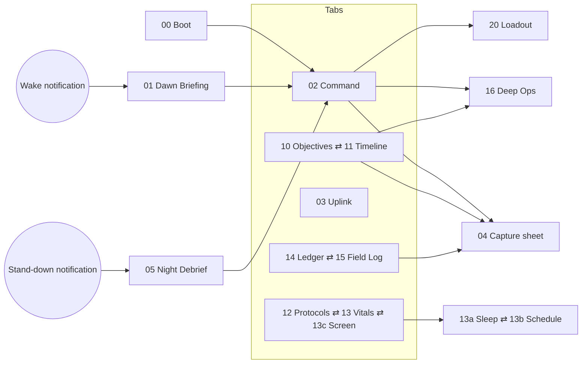

# VIGIL — Design Handoff v1.1

Personal daily ops companion · Flutter (Android first, iOS second) · dark only · on-device first
Source of truth: the **VIGIL — Daily Ops Companion** design canvas (19 artboards). This document and the package around it are everything needed to build it.

---

## 0. What's in this package

| Path | What it is |
|------|------------|
| `HANDOFF.md` | This spec: foundations, components, every screen, copy, accessibility, QA |
| `VIGIL-Architecture-Spec.md` | On-device architecture: data model, engines, sleep recommender, digital wellbeing, Google integration, background work |
| `tokens/vigil.tokens.json` | Design tokens in the W3C DTCG format (colour, type, space, size, shape, motion) |
| `flutter/lib/vigil/` | Drop-in Flutter design system: theme, tokens, 20+ widgets, the Command reference screen and a component gallery |
| `flutter/pubspec_snippet.yaml` | Dependencies, assets and launcher-icon config to merge |
| `assets/svg/emblem*.svg` | Emblem: on dark, on signal, mono |
| `assets/svg/icons/*.svg` | 31 UI icons (24 grid, 1.6 stroke) |
| `assets/app_icon/` | iOS 1024 (default + signal variant), Android adaptive foreground / background / monochrome, notification icon, Play Store 512 |

**Getting the screens as images:** open the canvas and use **Share › Export** (PNG or PDF per artboard). Every artboard with a blue mark has a **Play** mode, so you can click through the real interactions.

**Quick start**

1. Copy `flutter/lib/vigil/` into your app's `lib/`, and `assets/` into the project root.
2. Merge `pubspec_snippet.yaml`, then run `flutter pub get` and `dart run flutter_launcher_icons`.
3. Set `MaterialApp(theme: buildVigilTheme(), themeMode: ThemeMode.dark)`.
4. Run `lib/main.dart` to see the gallery, or switch `home:` to `CommandScreen()`.

> The Dart code was reviewed by hand but **not compiled**, because Flutter's servers were blocked in the session that produced it. Run `flutter analyze` first and expect at most minor fixes. The minimum is Flutter 3.27.

---

## 1. Product and information architecture

**VIGIL** is a personal ops system with a terse "tactical computer" assistant. Everything is framed as ops:

| Plain term | VIGIL term | Where it lives |
|------------|-----------|-------|
| Home | **COMMAND** | Tab 1 |
| Tasks | **OBJECTIVES** | Tab 2 · Ops |
| Calendar | **TIMELINE** | Tab 2 · Ops |
| Assistant | **VIGIL UPLINK** | Tab 3 (raised core button) |
| Habits | **PROTOCOLS** | Tab 4 |
| Health | **VITALS** | Tab 4 |
| Sleep | **SLEEP** (tracker + schedule) | Vitals › Sleep |
| Digital wellbeing | **SCREEN** | Tab 4 |
| Money | **LEDGER** | Tab 5 · Vault |
| Notes + journal | **FIELD LOG** | Tab 5 · Vault |
| Focus timer | **DEEP OPS** | Full screen |
| Morning summary | **DAWN BRIEFING** | Full screen at wake |
| Evening review | **NIGHT DEBRIEF** | Full screen at stand-down |
| Settings | **LOADOUT** | Pushed from Command |
| Quick add | **CAPTURE** | Bottom sheet, from anywhere |

### Navigation map

### Routes (`go_router`, with a `StatefulShellRoute` for the 5 tabs)

| Route | Screen | Presentation |
|-------|--------|--------------|
| `/boot` | 00 Boot | First run only; replaces the stack |
| `/briefing/:date` | 01 Dawn Briefing | Full-screen modal, no tab bar |
| `/` | 02 Command | Tab 1 |
| `/ops/objectives`, `/ops/timeline` | 10, 11 | Tab 2. The segmented control swaps routes without animation. |
| `/vigil` | 03 Uplink | Tab 3 |
| `/protocols/habits`, `/protocols/vitals`, `/protocols/screen` | 12, 13, 13c | Tab 4, segmented |
| `/protocols/vitals/sleep`, `…/sleep/schedule` | 13a, 13b | Pushed; back returns to Vitals; no tab bar |
| `/vault/ledger`, `/vault/log` | 14, 15 | Tab 5, segmented; biometric gate on entry |
| `/capture?type=` | 04 Capture | Modal bottom sheet over the current route |
| `/deep-ops?objective=` | 16 Deep Ops | Full screen, no tab bar, stealth ground |
| `/debrief/:date` | 05 Night Debrief | Full-screen modal |
| `/loadout` | 20 Loadout | Pushed |

**Back behaviour (Android):**
- Back on a tab root goes to Command; back on Command exits.
- Back on a modal closes it.
- Deep Ops asks before abandoning a running session ("ABORT SESSION?").

---

## 2. Foundations

### 2.1 Colour (dark only)

| Token | Hex | Use | Contrast |
|-------|-----|-----|----------|
| `ground` | `#0A0B0D` | Scaffold | — |
| `stealth` | `#050607` | Deep Ops, widgets, scrims | — |
| `surface` | `#121418` | Cards, sheets, inputs | — |
| `surfaceHigh` | `#1A1D22` | User bubbles, selected rows | — |
| `navBar` | `#0E0F12` | Bottom bar | — |
| `line` | `#262A31` | Card borders, dividers, empty bar tracks | decorative |
| `lineStrong` | `#363B44` | Inputs, secondary buttons, segmented outline | decorative (see 7) |
| `rule` | `#1E2126` | Chart gridlines | decorative |
| `neutral` | `#646A74` | Unchecked checkboxes, switch-off border, meeting blocks | 3.4 : 1 on surface ✅ (canvas used `#5A606A` at 2.9 : 1; corrected in code) |
| `text` | `#ECEAE4` | Primary copy | 15.3 : 1 on surface |
| `textMuted` | `#A3A8B0` | Secondary copy | 7.7 : 1 |
| `textFaint` | `#8A9099` | Mono labels, metadata | 5.7 : 1 on surface, 5.3 : 1 on surfaceHigh |
| `signal` | `#F2C230` | **The only accent:** primary actions, active state, progress | 11.0 : 1 on surface; `onSignal` on it 11.8 : 1 |
| `onSignal` | `#0A0B0D` | Text and icons on signal or critical fills | — |
| `critical` | `#FF5A47` | Deadlines, overdue, risk, over-limit. **Never decorative.** | 6.0 : 1 on surface; `onSignal` on it 6.4 : 1 |
| `steel` | `#7FA7C9` | Water, sleep, second data series | 7.3 : 1 |
| `sleepBand` | `#1F2630` | Sleep-window shading in charts | decorative |

**Rules:**
- One accent per screen does the shouting; critical red is reserved for risk.
- Signal and critical also differ in lightness, so they never rely on hue alone.
- The accent can be swapped in Loadout (cyan `#5CC8FF`, orange `#FF7A3D`, white `#ECEAE4`). All keep onSignal text at ≥ 7.6 : 1. Build every widget from `context.vigil.signal`, never a literal yellow.
- **Focus-block tint** = signal at 14 %. **Switch-on track** = signal at 15 %.

### 2.2 Typography

Bundle the fonts (no runtime fetch): **Chakra Petch** 500/600/700 · **IBM Plex Sans** 400/500/600 · **IBM Plex Mono** 400/500/600.

| Token | Family | Size / line | Weight | Tracking | Case | Used for |
|-------|--------|-------------|--------|----------|------|----------|
| `display` | Chakra | 66 / 1.0 | 600 | +4 % | — | Deep Ops timer (tabular figures) |
| `hero` | Chakra | 40 / 1.0 | 700 | 0 | — | Sleep plan times. Mission score uses 64. |
| `h1` | Chakra | 31 / 1.1 | 600 | +1 % | Sentence | Command greeting |
| `section` | Chakra | 26 / 1.0 | 700 | +14 % | UPPER | Screen titles |
| `h2` | Chakra | 24 / 1.22 | 600 | 0 | Sentence | Briefing headline |
| `metric` | Chakra | 22 / 1.05 | 700 | 0 | — | Tile values (tabular) |
| `title` | Plex Sans | 17 / 1.3 | 600 | 0 | Sentence | Profile name, sheet titles |
| `rowTitle` | Plex Sans | 15 / 1.3 | 500 | 0 | Sentence | List rows |
| `body` | Plex Sans | 15 / 1.45 | 400 | 0 | Sentence | Messages, descriptions |
| `caption` | Plex Sans | 13 / 1.35 | 400 | 0 | Sentence | Card sub-copy |
| `button` | Plex Mono | 12 / 1.0 | 600 | +14 % | UPPER | Buttons, segmented, chips |
| `cta` | Chakra | 16 / 1.0 | 700 | +22 % | UPPER | 54–56 px CTAs |
| `label` | Plex Mono | 11 / 1.2 | 500 | +16 % | UPPER | Section labels |
| `meta` | Plex Mono | 11 / 1.3 | 400 | +4 % | UPPER | Row metadata, timestamps |
| `micro` | Plex Mono | 10 / 1.2 | 400 | +10 % | UPPER | Nav labels, axis ticks |

Tracking is in em in the design and converted to px in `VigilType` (`em × size`). Case is applied at the call site, never with a text transform in the style.

### 2.3 Layout and spacing

- **Frame:** 390 × 844 logical px (designs are 1×). Test at 360 and 430 widths. Content is a single column with a **20 px gutter**.
- **Top:** the canvas reserves 56 px for the status bar. In Flutter use `SafeArea(bottom: false)` plus 12 px.
- **Bottom:** the tab bar is 66 px plus the bottom inset (minimum 18). Scroll views need about 120 px of bottom padding so the last card clears the raised core button.
- **Spacing scale:** 4 · 8 · 12 · 16 · 20 · 24 · 32. Gap between sections = 12 (18 under the Command greeting). Card padding = 14 (16 on hero cards). Row height = 56 (44 compact).
- **Grid texture:** 26 px square grid, 1 px lines in `text` at 3 % (`GridBackground`). Widgets and the lock screen use a 14 px diagonal hatch at 3.5 %. Deep Ops has no texture.
- **Phone-height rule:** everything above the tab bar should fit 844 px without scrolling on the primary screens. Taller screens (Loadout, Sleep Schedule) scroll.

### 2.4 Shape

| Shape | Spec | Flutter |
|-------|------|---------|
| Square (default) | radius 0, 1 px border | `RoundedRectangleBorder(side: …)` |
| **Chamfer** | top-right and bottom-left cut: 10 px (≤ 44 px buttons), 12 px (54–56 px CTAs), 14 px (widgets, dialogs), 8 px (widget buttons) | `VigilShapes.chamfer(cut)` → `BeveledRectangleBorder` |
| **Octagon** | 30 % cut | `VigilShapes.octagon(size)` |
| **Sheet** | top-left and top-right cut 18 px | `VigilShapes.sheet()` |
| **Corner brackets** | 12 px L, 2 px, signal (critical on alerts), top-left + bottom-right | `CornerBrackets` |

Brackets mark **hero and intel cards only**: readiness, VIGIL intel, mission score, tonight's sleep plan, the consistency heatmap, the ledger month card and the night-log card. Don't add them elsewhere.

### 2.5 Iconography

The 24 px grid, 1.6 stroke, butt caps and miter joins come from `assets/svg/icons/` through `VigilIcon` (tinted with `srcIn`). Size is 22 in the tab bar, 18–20 in headers and buttons, 16 in steppers. Filled shapes are limited to `play`. Never use emoji.

### 2.6 Emblem

- Shield outline + visor slit + centre diamond. Use `VigilEmblem` in code and the SVGs for launchers.
- The visor is **signal on dark** and **ground on signal**. Drop the diamond below 24 px.
- Minimum size 16 px; clearspace equals the visor height.
- Sizes: 28 in the Command header, 30 in the core button (dark on signal), 80 on Boot inside 124 px corner brackets.
- The emblem is VIGIL's own mark. Don't substitute third-party logos or characters.

### 2.7 Motion and haptics

| Event | Motion | Haptic |
|-------|--------|--------|
| Toggle, check, select | 120 ms easeOutCubic colour/position | light impact (checks), selection click (switches, segments) |
| Sheet / route push | 220 ms | — |
| Primary commit (COMMIT, ARM, ENGAGE) | Button press | medium impact |
| Critical alert arrives | Card fades in 220 ms, no shake | heavy impact (only if the app is open) |
| **Signature moment · Boot** | Boot log lines type in over about 600 ms each, then the visor fills last | — |
| Listening (Uplink) | 5 bars scale 0.35 → 1, 0.9 s loop, staggered 150 ms | — |
| Deep Ops tick ring | Ticks light clockwise each second; no easing | — |

All motion respects `MediaQuery.disableAnimations` (reduced motion): loops stop and transitions become instant.

### 2.8 Formatting rules

| Kind | Format | Example |
|------|--------|---------|
| Time | 24 h `HH:mm` | 18:42 |
| Day stamp | `EEE dd MMM` UPPER | THU 22 OCT |
| Duration | `Hh MMm` (labels) or `HhMM` (compact) | 7h 12m · 7h12 |
| Countdown | `T–N MIN` | T–18 MIN |
| Money | ₹ + Indian grouping, no decimals unless needed (`NumberFormat.currency(locale: 'en_IN', symbol: '₹', decimalDigits: 0)`) | ₹24,860 |
| Debit in lists | `−₹180`, using a true minus sign (U+2212) | −₹180 |
| Percent | No space | 62% |
| Ranges | En dash, no spaces | 19:00–19:45 |
| Arrows | → for moves and spans | 23:00 → 06:30 |

---

## 3. Components

Every component below exists in `flutter/lib/vigil/widgets/`. Sizes are logical px.

### 3.1 Buttons — `VigilButton`

| Variant | Fill / border | Label | Height | Shape | Use |
|---------|---------------|-------|--------|-------|-----|
| `primary` | signal fill | onSignal, `button` | 44 | chamfer 10 | One per view: LOG 500 ML, ARM, APPLY, PAY |
| `primary · large` | signal fill | onSignal, `cta` | 54 (56 for Debrief / Deep Ops) | chamfer 12 | INITIATE, COMMIT, ACKNOWLEDGE · DEPLOY, STAND DOWN, ENGAGE |
| `secondary` | transparent, lineStrong 1 px | textMuted | 44 | square | SNOOZE, UNDO, ADJUST, ABORT, NOT NOW |
| `accent` | transparent, signal 1 px | signal | 44 | square | → FRI, GRANT MIC |
| `ghost` | none | textMuted | 44 | square | Inline UNDO inside a status bar |
| `critical` | critical fill | onSignal | 44 | chamfer 10 | Destructive confirms only (ERASE ALL) |

- **States:** pressed = ink ripple at 6 % text; disabled = 40 % opacity and not focusable; focus = 2 px signal outline offset 2 (keyboard / switch access).
- **Labels:** always UPPERCASE and one line. Truncate the label, never the button.
- An icon (16, or 20 on large) can sit before the label, with an 8 px gap.

**Other buttons:**
- `VigilIconButton`: 44 × 44, surface fill with a line border, 20 px icon. An optional `badge` adds a 7 px critical square at top 9 / right 10 (unread alerts).
- `OctagonButton`: FAB 56 (signal fill, + icon, positioned right 20 / bottom 100) and the core VIGIL button 58 (raised 20 px).

### 3.2 Selection controls

| Component | Spec | States |
|-----------|------|--------|
| `VigilCheckbox` | 20 px square, 1.5 px border, inside a 44 hit area | off: neutral border · off-critical: critical border (CRIT objectives, at-risk protocols) · on: signal fill + 3.2 px onSignal check · the row title gets strikethrough and textFaint |
| `VigilSwitch` | 44 × 24 square track, 1 px border, 16 px square knob, 3 px inset; hit area 52 × 44 | off: neutral border, textFaint knob, left · on: signal border, signal 15 % track, signal knob, right |
| `VigilSegmented` | Full width, lineStrong outline, 44 tall, 2–3 equal segments | selected: signal fill, onSignal 600 · others: textMuted 400 |
| `VigilFilterChip` | 44 tall, 14 px padding, 1 px border, `button` style at weight 400 | selected: text-colour border + text · others: lineStrong border + textMuted |
| Mood selector (Field Log) | 5 equal buttons 60 tall; a 1–5 bar glyph (3 px bars, 6–18 px tall) over a 10 px label | selected: signal border, surfaceHigh fill, lit bars in signal |
| Type selector (Capture) | 5 equal segments, 44 tall, 10 px labels | as segmented |
| Threat selector (Capture) | 3 buttons, 44 tall, 8 px dot in the threat colour + label | selected: border in the threat colour, surfaceHigh fill |
| `VigilStepper` | 44 square − / + buttons with a lineStrong border; value in `metric`, centred (76–96 wide) | value announced through a live region |

### 3.3 Inputs

- **Text field:** 48 tall (52 in the Uplink composer), surface fill, 1 px lineStrong border, 14 px horizontal padding, 15–17 px body text. Focus = signal border. Error = critical border plus a critical `meta` message below.
- **Label:** an external `label` above the field (UPPER mono 11, textFaint). The Uplink composer and Field Log search use a hidden label with `Semantics(label:)`.
- **Textarea** (Capture, Night log): ground fill (darker than the card), signal border while active, 2 lines, no resize.
- **Time pickers** (Boot WAKE / STAND DOWN, Sleep schedule): the field is a button showing `HH:mm` plus an icon (sun / moon). Tapping opens the platform time picker themed with VIGIL colours. In the Sleep schedule, editing happens inline with ±15 steppers.

### 3.4 Tags and chips

- `ThreatTag`: 22 tall, 6 px padding, `micro` 600. CRIT = critical fill, onSignal text · HIGH = signal outline and text · ROUTINE = neutral outline, textMuted.
- `ParsedChip` (Capture): 32 tall, key cell (textFaint) | value cell (text), 1 px dividers. `uncertain` = signal outline, and the screen reader appends "please confirm".
- **Status chips** (Loadout links): 6 px square dot + label in signal (LINKED / ON) or textMuted (ASK).
- **TONIGHT tag** (Sleep schedule): 18 tall, signal fill, 9 px mono.

### 3.5 Cards — `VigilCard`, `IntelCard`, `StatTile`

- **Card:** surface fill, 1 px line border, square corners, 14 px padding. Hero cards add `CornerBrackets`. Tappable cards get an ink ripple and a trailing chevron (Next op, Sleep tile).
- **Intel card:** lineStrong border, brackets, tag `VIGIL // INTEL` (signal) or `VIGIL · ALERT` (critical), timestamp on the right, one or two sentences of body text, up to two actions. On resolve the body is replaced by a one-line confirmation ("Logged. Hydration 1.7 of 3.0 L…") and the actions disappear. It is a polite live region.
- **Stat tile:** micro label, `metric` value, optional `meta` caption. Use valueColor critical only for risk values (debt, over-limit).
- **List container:** one card with rows separated by 1 px line rules. No rule above the first row.

### 3.6 Data display — `charts.dart`

| Widget | Spec | Used on |
|--------|------|---------|
| `ReadinessRing` | 84 px, 7 px arc from 12 o'clock in signal on a line track, 4 compass ticks (neutral, 5 px), value 26 px + "READY" 9 px | Command, widgets |
| `StatBar` | label + value row, 4 px bar (signal, or steel for the focus series) | Command |
| `SegmentBar` | 4–10 px bar; optional 2 px text-colour marker overhanging 4 px (budget pace, limit line) | Ledger, Screen, Vitals |
| `MiniBars` | Equal-width bars, 2–8 px gaps, optional dashed reference line in textMuted | Uplink food chart, Debrief trend, Vitals sleep, Screen hourly |
| `WindowBar` | One night on a 21:00 → 09:00 axis: dashed signal **plan** outline, solid steel **asleep** bar (signal for last night), gridlines at 00/03/06 | Sleep tracker, Ops window (Briefing) |
| `TickRing` | 264 px, 48 radial ticks (16 px every 4th, otherwise 9 px), lit clockwise in signal; 1 px inner reticle | Deep Ops |
| Heatmap | 12 columns (weeks) × 7 rows (days), 9 px cells, 3–4 px gaps, 5 levels: line → signal at 28/50/75/100 %. Future cells dashed. | Protocols |
| Timeline | 30 px/hour, 40 px hour gutter, blocks: event (surfaceHigh + lineStrong), focus (signal 14 % + signal), personal/task (dashed neutral), conflict (critical 12 % + critical, split lanes). NOW line: 2 px critical with a 36 × 16 time tag. | Timeline |
| Waveform | 38 bars, 2 px gaps; played = signal, remaining = lineStrong | Briefing |

**Chart rules:**
- Every chart has an `aria`-style summary (`semanticLabel`).
- Never use colour alone: over-limit bars also get a critical value label.
- Axes use `micro` in textFaint.

### 3.7 Navigation — `VigilNavBar`, `VigilScaffold`

- **Tab bar:** navBar fill, 1 px line top border, 5 equal slots (icon 22 + 5 px gap + micro label).
  - Active slot: signal icon and label, plus a 26 × 2 signal indicator at the top edge.
  - Centre slot: the 58 px octagon (signal, dark emblem) raised 20 px, with the label "VIGIL" 8 px from the bottom.
  - Use `Scaffold(extendBody: true)`.
- **Screen header:** 44 tall. `section` title plus an optional micro subtitle (textFaint) on the left, 44 px icon buttons on the right. Pushed screens put a 44 px back button with a chevron first.
- **Segmented view switch** sits 12 px below the header (2 or 3 options).
- **Bottom sheet** (Capture):
  - 62 % stealth scrim; the sheet's top edge is a 2 px signal border with 18 px chamfered corners.
  - 40 × 4 drag handle; 20 px padding; 34 px bottom inset.
  - Swipe down or the ✕ closes it; COMMIT commits.

### 3.8 Feedback

- **Snackbar:** floating, surfaceHigh with a lineStrong border, `body` text, signal action (UNDO). Used after swipe actions and assistant writes made outside Uplink.
- **Confirm card (assistant):** an intel card variant with the diff rows plus CONFIRM (primary) and CANCEL (secondary).
- **Loading:** no spinners on local data. Network actions (Calendar sync, cloud AI) show a mono `tool_status` line ("SYNCING CALENDAR…") with a 2 px indeterminate signal bar.

---

## 4. Screens

Format for each screen: **route**, then **layout** top to bottom (with heights), then **data**, **interactions**, and **states** (empty / loading / offline / permission), then copy notes. The sample data matches the canvas (Thursday 22 Oct, 18:42).

---

### 00 · Boot · Onboarding — `/boot`

**Layout** (no tab bar; 60 top, 24 gutter)
1. Emblem 80 inside a 124 × 124 box with four 18 px signal corner brackets
2. "VIGIL": Chakra 42/700, +34 % tracking. Below it, `PERSONAL OPS SYSTEM · v1.0` in micro textFaint.
3. **System links** card: a mono 12 boot log, one row per link, status on the right:
   - Calendar link · Health Connect · Notifications · **Usage access** · **Exact alarms** · Voice uplink
   - A missing permission shows an accent `GRANT …` button (30 tall) instead of a status.
4. **CALLSIGN** input (48)
5. **WAKE · WEEKDAYS** and **BED · WEEKDAYS** time buttons, side by side (48). These seed `sleep_schedule`, and every night can be refined later in 13b.
6. **ARM MODULES** chips (wrap, 36 tall, 8 px square indicator), with an `n / 7` counter: OBJECTIVES, TIMELINE, PROTOCOLS, VITALS, DEEP OPS, FIELD LOG, LEDGER
7. **INITIATE** large primary CTA (54, chamfer 12, arrow icon)
8. A secondary text link below it: `RESTORE FROM DRIVE`

**Interactions**
- Each GRANT opens the system flow: Google sign-in, the Health Connect permission sheet, the notification permission, the Usage access settings deep link, the exact-alarm settings deep link, the mic permission.
- When a flow returns, the row animates to `OK` (signal).

**States**
- A denied permission row shows `DENIED · TAP TO RETRY` (textMuted) and never blocks INITIATE. The affected modules show their own empty states later.
- First launch only. Boot is skipped once `settings` exists.

---

### 01 · Dawn Briefing — `/briefing/:date`

Opened from the wake notification or the Command card before 10:00.

**Layout**
1. Header: `DAWN BRIEFING` (label, signal) over `06:30 · THU 22 OCT`, with a close button
2. **Player** card: 44 px octagon play/pause, 38-bar waveform, `0:48 / 2:04`. On-device TTS reads the script; progress follows the TTS position.
3. Headline (`h2`): one or two sentences, with risk words in critical ("one critical")
4. **PRIMARY OBJECTIVES**: up to 3 rows (52): ThreatTag, title, due
5. **OPS WINDOW**: 06:00 → 24:00 bar (28) with focus blocks (signal) and meetings (neutral), a NOW marker, ticks every 3 h, and a legend line
6. Two tiles, **CONDITIONS** (weather, optional) and **LEDGER** (yesterday's spend, month %)
7. **ACKNOWLEDGE · DEPLOY** large primary → Command

**States**
- **Weather off or unavailable:** the conditions tile becomes **SLEEP** ("7h 12m · debt −2h 03m").
- **TTS unavailable:** hide the player and show the script as text.
- **Composed late** (iOS): show "Briefing compiled 06:52".

---

### 02 · Command · Home — `/` (Tab 1)

Reference implementation: `examples/command_screen.dart`.

**Layout**
1. Header: emblem 28 + `VIGIL` (mono 13, +26 %) over `● SYSTEMS NOMINAL` (signal micro). On the right, Alerts (badge) and Loadout icon buttons.
2. Greeting:
   - stamp `THU 22 OCT · 18:42 IST` (meta 12, textFaint)
   - `Evening, Chandan.` (h1)
   - status line: "6 objectives open. **1 critical**. Next op in 18 min." The critical part is in critical colour.
3. **OPS READINESS** hero card (brackets): ReadinessRing 84 next to 3 StatBars (Objectives, Protocols, Deep ops in steel), with `UPD hh:mm` top right
4. **Intel card:** the single highest-priority insight from the rules engine, with 1–2 actions
5. **Next op** card (68), tappable → Timeline: `T–MIN` column (52 wide, number in signal), title, mono meta, chevron
6. **Quick actions** grid, 4 × 72: DEEP OPS (signal bolt), CAPTURE, WATER (steel drop), EXPENSE (₹)
7. Tab bar

**Interactions**
- Intel actions resolve inline.
- WATER logs +250 ml immediately and shows a snackbar with UNDO; long-press it for +500.
- EXPENSE opens Capture with `type=expense`.

**States**
- **Nothing urgent:** the intel card shows "All clear. Next op 19:00." with no actions.
- **No calendar:** the Next op card shows the next objective with a due time instead.
- **Greeting by time:** Morning before 12:00, Afternoon before 17:00, otherwise Evening.

---

### 03 · VIGIL Uplink · Assistant — `/vigil` (Tab 3)

**Layout**
1. Header: emblem 30 + `VIGIL UPLINK`, status `● ONLINE · ON-DEVICE` (or `● CLOUD ASSIST` when cloud AI handled the last turn), and a history button
2. **Conversation:** bottom-anchored list with a 36 px fade under the header
   - **User bubble:** right-aligned, max 82 % wide, surfaceHigh with a lineStrong border, 15 px body, time in micro
   - **VIGIL message:** left-aligned, max 92 % wide, label `VIGIL · 16:01` (signal; critical for alerts), body text, then optional cards:
     - **diff card:** MOVED / BLOCKED rows, 62 px label column, bracket top-left, UNDO
     - **bar chart card:** MiniBars + day letters
     - **confirm card**
3. **Suggestion chips**: one row, 44 tall (Plan my day · What's overdue? · Week report). Generated from the SITREP.
4. **Composer:** attach (44 × 52), field ("Command VIGIL…", 52), mic octagon 52 (signal)
5. Tab bar

**Interactions**
- **Mic:** tap to start; the chips row is replaced by a `LISTENING` strip (signal border, 5 animated bars, live transcript). Tap again or stay silent for 1.5 s to send.
- **UNDO** on a diff card reverts the change and the card text changes to `UNDONE`.
- **Long-press a VIGIL message:** Copy · Why? (shows the tools used and their data) · Report.

**States**
- **Model loading:** composer hint "VIGIL warming up…", with input still allowed and queued.
- **Offline with cloud AI on:** hard intents fall back to the local model with the note "Local mode: reduced planning."
- **Empty thread:** a centred emblem 48 plus 3 starter chips.

---

### 04 · Quick Capture — `/capture` (bottom sheet)

**Layout** (the sheet starts at about 30 % from the top)
1. Drag handle; `CAPTURE` (Chakra 22) + `SAY IT ONCE. VIGIL SORTS IT.` (micro); close button
2. **Type** segmented, 5 options: OBJ · EVENT · NOTE · SPEND · HABIT. It auto-selects from parsing and can be overridden.
3. **PLAIN WORDS** textarea (78, signal border), focused on open with the keyboard up
4. **VIGIL PARSED** chips: TYPE · WHEN · ₹ · TAG (amber outline = uncertain; tap to edit)
5. **THREAT LEVEL**: 3 buttons (CRIT / HIGH / ROUTINE)
6. **Reminder** row (52): "REMIND 30 MIN BEFORE" + chevron
7. Voice octagon (54, surfaceHigh) + **COMMIT** large primary

**Interactions**
- Parsing runs on every keystroke (debounced 150 ms, under 50 ms) and the chips update live.
- COMMIT writes the item, closes the sheet and shows a snackbar such as `OBJECTIVE LOGGED · FRI 23 OCT 18:00 · UNDO`.

**States**
- **Empty input:** COMMIT disabled; the chips area shows examples in textFaint ("Try: lunch 180 · call home 9pm · read 20 pages daily").

---

### 05 · Night Debrief — `/debrief/:date`

**Layout** (stealthier ground `#08090B`)
1. Header: `NIGHT DEBRIEF` + `22:30 · THU 22 OCT`, close button
2. **MISSION SCORE** hero card: 64 px number in signal, `/ 100`, `+6 VS 7-DAY AVG`, and a 7-bar trend on the right (today in signal)
3. 2 × 2 metric tiles: OBJECTIVES, PROTOCOLS, DEEP OPS, HYDRATION, each with a 3 px bar
4. **CARRY OVER** rows (56): title + `→ FRI` (accent) and `DROP` (secondary). After a choice the buttons are replaced by `MOVED → FRI` / `DROPPED`.
5. **TOMORROW · FIRST OBJECTIVE** picker row (52, ThreatTag + title + time ▾)
6. **ONE LINE FOR THE LOG** input. It saves to the Field Log journal for today.
7. **STAND DOWN** large primary (56): moon icon + "ALERTS SILENT UNTIL 06:30". It arms quiet hours and Night Shield.

**States**
- **Nothing to carry over:** "Clean sweep. Nothing carries over."

---

### 10 · Ops · Objectives — `/ops/objectives` (Tab 2)

**Layout**
1. Header: `OPS` + `6 OPEN · 3 CLEARED · 1 OVERDUE` (overdue in critical), search button
2. Segmented: **OBJECTIVES** | TIMELINE
3. Filter chips: ALL · WORK · HOME · RECURRING · NO DATE
4. Groups **CRITICAL · n** (critical), **HIGH · n** (signal), **ROUTINE · n** (textMuted). Each group label has an 8 px square, followed by a list card.
   - **Row (56):** checkbox | title + meta (`DUE 20:00 · WORK · 3/5 · ~90M`; overdue in critical) | optional Deep Ops button (44, bolt) on objectives with an estimate
5. `CLEARED TODAY · n` dashed row, expandable
6. FAB → Capture (`type=objective`)

**Interactions**
- **Check:** strikethrough and the cleared count updates. The row stays in place until the next visit; this is intentional.
- **Swipe right:** complete. **Swipe left:** reschedule sheet (Today evening · Tomorrow · Next week · Pick).
- **Tap a row:** detail sheet (notes, subtasks, recurrence, linked ledger item).

**States**
- **No objectives:** emblem 40 + "No objectives. Clear skies." + `CAPTURE` button.

---

### 11 · Ops · Timeline — `/ops/timeline` (Tab 2)

**Layout**
1. Header: `OPS` + `THU 22 OCT · 8 OPS · 3h30 FOCUS`, month-view button
2. Segmented: OBJECTIVES | **TIMELINE**
3. **Week strip:** 7 buttons (60 tall) with day, date and a load bar (7 px per op). Selected = signal fill; today has a signal load bar.
4. **Day timeline** 08–22 (30 px/h): hour labels plus rules, block types as in 3.6, and the NOW line
5. **Conflict card:** critical border, `CONFLICT · 15 MIN OVERLAP`, a description and a **RESOLVE** primary. Resolved, it turns into a neutral border with `RESOLVED` in signal.

**Interactions**
- Tap a block → detail. Long-press and drag a focus block to move it (snaps to 15 min); events from Google with attendees can't be dragged.
- Tap an empty slot → Capture with `type=event` and the time prefilled.
- Swipe the timeline horizontally to change day.

**States**
- **Calendar not linked:** a banner at the top, "Calendar not linked · LINK", and VIGIL-only blocks still show.
- **Sync stale over 2 h:** a micro `LAST SYNC 14:10` in critical next to the header.

---

### 12 · Protocols · Habits — `/protocols/habits` (Tab 4)

**Layout**
1. Header: `PROTOCOLS` + `4 / 6 TODAY`, add button
2. Segmented (3): **PROTOCOLS** | VITALS | SCREEN
3. **CONSISTENCY · 12 WEEKS** hero card: heatmap + `81%` (metric, signal) + legend `LESS ■■■■■ MORE` with AUG / OCT
4. `DAILY` / `LAST 7 DAYS` label row, then a list card of protocols (58 rows):
   - checkbox
   - name + `STREAK n · DAILY`, or `AT RISK · 2 DAYS MISSED` in critical
   - 7 mini bars (9 × 18; today's has a textFaint border when open)

**Interactions**
- **Check:** streak +1 and today's bar fills.
- **Quantified protocols** (pages, minutes): the check opens a small stepper sheet.
- **Long-press:** edit schedule or target, pause.

**States**
- **No protocols:** "No protocols armed." + suggestions as chips (Read 20 pages · Workout 30 min · Lights out by 23:00).

---

### 13 · Vitals · Health — `/protocols/vitals` (Tab 4)

**Layout**
1. Header: `VITALS` + `SYNCED · HEALTH CONNECT · 18:30`, sync button
2. Segmented (3): PROTOCOLS | **VITALS** | SCREEN
3. **HYDRATION** hero card (steel bracket): `1.2 / 3.0 L`, a 12-cell tank (250 ml each, steel), `+250 ML` (secondary) and `+500 ML` (primary)
4. Two tiles:
   - **SLEEP ›** (tappable → 13a): 7h 12m, `23:48 → 07:00`, 7-night mini bars with a dashed target line
   - **STEPS:** 6,420 / 8,000, a 60 px ring, `1,580 TO TARGET`
5. **WORKOUT** card. When the protocol is at risk it gets a critical border and `START 20 MIN` → Deep Ops in workout mode.
6. **BODY** card: weight + `−0.6 KG`, a 30-day sparkline (steel), resting HR

**States**
- **Health Connect not granted:** each card shows "No data · CONNECT", and hydration still works because it's logged locally.

---

### 13a · Sleep · Tracker and recommender — `/protocols/vitals/sleep`

**Layout** (pushed, no tab bar)
1. Header: back + `SLEEP` + `NEED 7h 15m · SYNCED 07:02`
2. Segmented: **TRACKER** | SCHEDULE
3. **Tonight** hero card (brackets ×2):
   - tag `VIGIL // TONIGHT · THU → FRI`, plus `PLAN 23:00`
   - `LIGHTS OUT 22:40` (hero, signal) → `WAKE 06:30` (hero), with the in-bed duration
   - a reason sentence (debt payback, phone after lights-out, wind-down time)
   - **ARM 22:40** (primary) and ADJUST (secondary → 13b). Once armed: `ARMED · WIND-DOWN 22:10` with UNDO.
4. Three tiles: AVG · 7N `6h 57m` · DEBT `−2h 03m` (critical) · BEDTIME `±53 min`
5. **LAST 7 NIGHTS** card:
   - legend: ASLEEP (steel) · PLAN (dashed signal)
   - 7 WindowBars, newest at the top in signal
   - per-night duration on the right; critical when under the need
   - axis 21 · 00 · 03 · 06 · 09
6. **Insight** card (one at a time): tag, sentence, `APPLY`. Applying patches the schedule and the text becomes "Applied. …"

**Logic:** Architecture spec §8 covers the recommendation formula, insights, data sources and alarms.

**States**
- **No sleep data yet:** "Sleep data builds after 3 nights. Phone-inferred until a wearable or sleep app writes to Health Connect."
- **Phone-inferred nights:** shown as hatched bars, with `≈` before the duration.

---

### 13b · Sleep · Weekly schedule — `/protocols/vitals/sleep/schedule`

**Layout** (scrolls; 390 × 920 on the canvas)
1. Header: back + `SLEEP` + `WEEKLY SCHEDULE · ALARMS ON-DEVICE`
2. Segmented: TRACKER | **SCHEDULE**
3. **SLEEP NEED** row: stepper ±15 between 6h and 10h, with the note `+15 MIN TO FALL ASLEEP IS ADDED`
4. Column header: NIGHT · BED · WAKE · IN BED
5. **7 night rows** (52), MON → TUE … SUN → MON:
   - bed and wake times (Chakra 17); bed times after midnight are shown in textMuted
   - in-bed duration, in critical when below need + 15
   - the `TONIGHT` tag on the current night
   - **Tap a row** to expand inline steppers (BED ±15, WAKE ±15). The selected row gets a surfaceHigh background.
6. `COPY THU TO MON–THU` (secondary) next to a `DRIFT 75 MIN` chip, in critical above 60
7. Options list with switches:
   - **Gentle alarm ramp** (10 min)
   - **Wind-down** (30 min before bed: mute + Night Shield)
   - **Auto-adjust for first op** (wakes you earlier if the calendar needs it)

**Rules**
- Each row is the *night starting that day*.
- Changes reschedule that night's alarm and wind-down immediately.
- Edits for tonight within 2 h of bed ask: "Apply to tonight only or every THU?"

---

### 13c · Screen · Digital wellbeing — `/protocols/screen` (Tab 4)

**Layout**
1. Header: `SCREEN` + `USAGE ACCESS · DATA STAYS ON-DEVICE`, app-limits button
2. Segmented (3): PROTOCOLS | VITALS | **SCREEN**
3. **TODAY** hero card:
   - `3h 12m / 3h 30m LINE` with a 6 px bar
   - `7-DAY AVG 3h 48m`
   - 3 inline stats: UNLOCKS · ALERTS · FIRST PICKUP
4. **BY HOUR** card: 24 bars in steel (Deep Ops hours in signal, the current hour in text, future hours dashed), sleep-window shading (sleepBand), Deep Ops windows outlined in signal, axis 00/06/12/18/24
5. **TOP CATEGORIES** list (44 rows): name, 8 px bar with a limit marker, minutes. Over limit = critical name, bar and value.
6. **Night Shield** insight card: tag `INTEL · SOCIAL OVER LINE` (critical) with a sentence and `ARM`. Armed, it reads `NIGHT SHIELD · ARMED` with the schedule.

**Interactions**
- Tap a category → per-app breakdown (app icon from the OS, minutes, launches, notifications, and a limit setter).
- The app-limits button opens the limit editor (`shield_rules`).

**States**
- **Usage access not granted:** the hero card is replaced by "Screen intel needs Usage access. Data stays on this phone. · GRANT".
- **iOS:** the card area embeds the Screen Time report extension (Architecture spec §9.4).

---

### 14 · Vault · Ledger — `/vault/ledger` (Tab 5)

Gated by biometrics on entry, and again after 60 s in the background.

**Layout**
1. Header: `VAULT` + `BIOMETRIC · LOCKS ON EXIT`, add button
2. Segmented: **LEDGER** | FIELD LOG
3. **Month** hero card:
   - `OCTOBER · DAY 22 / 31` with `UNDER PACE` (signal) or `OVER PACE` (critical)
   - `₹24,860 / ₹40,000`
   - 8 px bar with a pace marker
   - `SAFE TO SPEND TODAY ₹1,680` and `PACE 71%`
4. **BY CATEGORY** card:
   - stacked 10 px bar
   - 2-column legend with amounts; the over-pace category in critical
   - `FOOD +18% OVER PACE` at the top right
5. **BILLS DUE** list (56 rows): name, due date (critical if today), amount, `PAY` primary (→ confirm card: "Mark paid? VIGIL doesn't move money."). After confirming: `PAID ✓`.
6. **RECENT** list (52 rows): category monogram (34 square), merchant/note, time · category, −amount. A header note `AUTO-CAPTURED · SMS` appears in builds with SMS parsing.

**States**
- **No transactions this month:** "Ledger clean. Log the first spend." + CAPTURE.
- **Biometrics failed:** blurred content, a lock icon, and `UNLOCK`.

---

### 15 · Vault · Field Log — `/vault/log` (Tab 5)

**Layout**
1. Header: `VAULT` + `ENCRYPTED · ON-DEVICE`, tags button
2. Segmented: LEDGER | **FIELD LOG**
3. **NIGHT LOG** hero card:
   - date + `STREAK 15`
   - mood selector (LOW · FLAT · STEADY · GOOD · PEAK)
   - a 2-line textarea ("What moved the mission forward today?")
   - `DICTATE` (mic, secondary) and `SEAL ENTRY` (primary)
4. Search field (48, search icon inset)
5. **FIELD NOTES · n** list (68 rows): kind tag (PINNED signal · VOICE steel · NOTE neutral), title, one-line snippet, age (2H / 1D)
6. FAB (pencil) → Capture with `type=note`

**Interactions**
- Voice notes record with `record`, transcribe on the device, and play in the detail view with a waveform.
- After 22:00 the night-log card moves to the top. Once sealed, it collapses to "Sealed 22:41 · STEADY".

---

### 16 · Deep Ops · Focus — `/deep-ops?objective=`

**Layout** (stealth ground, no texture, no tab bar)
1. Header: `DEEP OPS` (signal) + `STEALTH MODE · READY/ENGAGED/PAUSED`, exit button
2. **TARGET** card: the objective, `CRIT · DUE 20:00 · 3/5 SUBTASKS`, and `CHANGE`
3. **TickRing** 264: `REMAINING` / `18:24` (display, tabular) / `SESSION 3 / 4`, plus 4 session pips (done = signal, current = text, future = line)
4. Session length segmented: 25 / 5 · 50 / 10 · 90 / 20
5. **Shields** list with switches:
   - **Silence alerts** (critical alerts and family still break through)
   - **Block distractors** (3 apps · social, video)
   - **Ambient: rain**
6. `ABORT` (secondary) + `ENGAGE / HOLD / RESUME` large primary

**Behaviour**
- **Engaging:** sets DND, arms the shield rules, keeps the screen on (optional), and shows an ongoing notification with the remaining time and HOLD.
- **When the session ends:** medium haptic, a chime (if ambient is on), and a break card.
- **Attempted opens of blocked apps** show the VIGIL shield overlay ("Deep Ops in progress · 18:24 left · OPEN ANYWAY") and are counted for the debrief.

---

### 20 · Loadout · Settings — `/loadout`

**Layout** (scrolls; 390 × 1180 on the canvas)
1. Back + `LOADOUT`
2. **Profile** row: emblem tile, callsign, `CALLSIGN · 24H CLOCK · IST · ₹ INR`
3. **VIGIL · VOICE** card:
   - PERSONA segmented (TACTICAL · BUTLER · QUIET), with a live sample line below
   - VERBOSITY segmented (TERSE · STANDARD · DETAILED)
4. **BRIEFINGS:** Spoken replies (wake phrase), Dawn briefing, Night debrief, as switches with their times
5. **LINKS:** Google Calendar (`DIRECT FROM PHONE · NO SERVER`) · Health Connect · Usage access · Bank SMS parser (sideload build), each with a status chip
6. **DATA & PRIVACY:** Vault biometric lock, **Cloud AI for hard requests** (off by default; turning it on asks for the API key and explains what's sent), Google Drive backup (status + last backup time)
7. Footer: `VIGIL v1.0 · BUILD 0001`. Add **Export data**, **Assistant log** and **Erase all** rows here; they're still to be designed and use the same row pattern.

**Accent colour:** add a SIGNAL row with 4 swatches (2.1) under Profile. It maps to `buildVigilTheme(signal:)`.

---

### 21 · Widgets and alerts

- **Critical notification:** surfaceHigh at 96 %, a 2 px critical top border, chamfer 14, emblem 16 + `VIGIL · NOW` + `CRITICAL`, one sentence, ENGAGE (primary, chamfer 8) and SNOOZE 15M.
- **Objectives widget** (4 × 2): a NEXT OP column (time 30 px in signal, title, T–MIN) next to 3 checkable objectives.
- **Readiness widget** (2 × 2): ring 84, `1 CRIT · 3/9 CLEAR`.
- **Hydration widget** (2 × 2): a vertical tank, litres, `+250 ML`.
- **Deep Ops bar** (4 × 1): signal fill, `ENGAGE 25:00` + target.
- **App icons:** DEFAULT (dark), SIGNAL (yellow), THEMED (Android 13+ monochrome).

Widgets render through `home_widget` from the cached SITREP JSON. Interactive widget actions (check, +250 ml) write through a background callback and refresh the widgets.

---

### 22 · Design system board

A visual reference for sections 2 and 3: emblem, tokens, type scale, shapes, components, nav, icons, voice glossary and the Flutter mapping snippet.

---

## 5. Voice and copy

**The tactical computer:** lead with the number, then the risk, then **one** recommendation.
- 24 h times and ₹ with Indian grouping.
- No exclamation marks, no praise, no emoji.
- Missing data reads "No data for X." Never guess.
- The persona (Tactical · Butler · Quiet) and verbosity change *phrasing only*, never the facts.

| Situation | Tactical (default) | Butler | Quiet |
|-----------|-------------------|--------|-------|
| Hydration nudge | "Hydration 1.2 of 3.0 L. Review at 19:00. Recommend 500 ml now." | "You're at 1.2 of 3 litres, and the review is at seven. Perhaps some water first?" | "1.2 / 3.0 L · drink 500 ml" |
| Deadline | "Client deck v2 due in 60 min. Deep-ops block ready." | "The client deck is due within the hour. Your focus block is ready when you are." | "Deck due 20:00 · focus ready" |
| Sleep | "Lights out 22:40 to pay back 2h 03m debt. Wind-down 22:10." | "An earlier night would help: 22:40, with wind-down from 22:10." | "Bed 22:40 · wind-down 22:10" |

**Microcopy library** (button labels are always UPPERCASE):

| Context | Copy |
|---------|------|
| Confirm write | `LOGGED.` · `MOVED → FRI.` · `DROPPED.` · `UNDONE.` |
| Undo snackbar | `OBJECTIVE LOGGED · UNDO` |
| Empty objectives | "No objectives. Clear skies." |
| Empty ledger | "Ledger clean. Log the first spend." |
| Empty protocols | "No protocols armed." |
| No sleep data | "Sleep data builds after 3 nights." |
| Usage access missing | "Screen intel needs Usage access. Data stays on this phone." |
| Offline (cloud AI) | "Local mode: reduced planning." |
| Calendar error | "Calendar sync failed. Last good sync 14:10. RETRY" |
| Biometric lock | "Vault locked. UNLOCK" |
| Destructive | "Erase all VIGIL data on this phone and in Drive? This can't be undone." → `ERASE ALL` |

---

## 6. Notifications, alarms and widgets

| Android channel | Importance | Examples | Sound / vibration |
|-----------------|-----------|----------|-------------------|
| `critical` | High (heads-up) | Deadline T-60, critical conflict | Default sound + vibration |
| `ops` | Default | Next op in 15 min, focus end | Vibration only |
| `protocols` | Low | Streak at risk | Silent |
| `sleep` | High (wind-down), alarm (wake) | Wind-down 22:10, lights-out 22:40, wake alarm | Alarm sound with a 10 min ramp |
| `screen` | Low | Limit at 80 %, Night Shield armed | Silent |
| `ledger` | Default | Bill due today | Vibration |
| `briefings` | Low + media action | Dawn briefing ready · ▶ PLAY | Silent |

- **Notification small icon:** `assets/app_icon/android/ic_stat_vigil_96.png` (white silhouette), with the accent colour set to `#F2C230`.
- **Ongoing notifications:** Deep Ops (remaining time + HOLD) and Night Shield (until 06:30 + DISARM).
- **Alert budget:** 6 proactive nudges a day, 45 min apart, quiet hours from stand-down to wake. Architecture spec §11 has the full rules.

---

## 7. Accessibility

- **Contrast:**
  - All text meets 4.5 : 1 (table 2.1); the smallest grey, `textFaint`, is 5.3 : 1 or better.
  - Control boundaries that carry meaning (checkbox, switch-off) use `neutral` `#646A74` at 3.4 : 1.
  - Input outlines (`lineStrong`) are decorative. Inputs are identified by their label and filled surface, and focus is a 2 px signal border.
- **Targets:** every interactive element is at least 44 × 44, including chips (44), steppers (44) and checkboxes (44 hit area around a 20 px box).
- **Semantics:**
  - Use the real roles: `button`, `checked`, `toggled`, `selected`, `header`, `liveRegion`.
  - Icon-only buttons carry labels ("Alerts, 2 new").
  - Charts expose one summary sentence.
  - The emblem is labelled "VIGIL" once per screen and decorative elsewhere.
- **Text scaling:**
  - Support up to **1.3×** without clipping: labels wrap, tiles grow taller, the tab-bar labels may truncate with a fade.
  - From 1.3× up, hide nav labels and keep the icons and the indicator.
- **Reduced motion:** waveform, listening bars and tick animation stop; transitions are instant.
- **Colour independence:** critical states always pair colour with text (`AT RISK`, `OVER PACE`, `+18%`) or a shape (border).
- **Screen reader order:** header → segmented → hero card → lists → actions → tab bar. The FAB is announced after the list.

---

## 8. Assets

| File | Size | Use |
|------|------|-----|
| `assets/svg/emblem.svg` | 48 box | In-app emblem on dark (or use `VigilEmblem`) |
| `assets/svg/emblem_on_signal.svg` | 48 box | Emblem on signal fills |
| `assets/svg/emblem_mono.svg` | 48 box | Single colour: splash, themed icon source |
| `assets/svg/icons/*.svg` (31) | 24 box | UI icons, `currentColor` |
| `assets/app_icon/ios/AppIcon-1024.png` | 1024 | iOS icon, opaque |
| `assets/app_icon/ios/AppIcon-Signal-1024.png` | 1024 | Alternate icon (yellow) |
| `assets/app_icon/android/ic_launcher_foreground.png` | 432 | Adaptive foreground (emblem in the 66 dp safe zone) |
| `assets/app_icon/android/ic_launcher_background.png` | 432 | Adaptive background `#0A0B0D` |
| `assets/app_icon/android/ic_launcher_monochrome.png` | 432 | Android 13+ themed icon |
| `assets/app_icon/android/ic_launcher_legacy_192.png` | 192 | Legacy launchers |
| `assets/app_icon/android/ic_stat_vigil_96.png` | 96 | Notification small icon |
| `assets/app_icon/store/play_store_512.png` | 512 | Store listing |

**Splash screen** (`flutter_native_splash`): background `#0A0B0D` with `emblem_mono` tinted `#ECEAE4` at 96 px; no text.

---

## 9. Implementation notes (Flutter)

1. **Theme:** use `buildVigilTheme(signal: settings.accent)`. Read tokens with `context.vigil` and `context.vtype`, and never hard-code hex values in screens.
2. **Fonts:** bundle the TTFs under `google_fonts/` and set `GoogleFonts.config.allowRuntimeFetching = false`. The app is on-device first.
3. **Numbers:** apply `FontFeature.tabularFigures()` to every changing number (timers, ring values, money). `metric`, `hero`, `display` and `meta` already include it.
4. **Formatting:** `intl`: `DateFormat('HH:mm')`, `DateFormat('EEE dd MMM').format(d).toUpperCase()`, and `NumberFormat.currency(locale: 'en_IN', symbol: '₹', decimalDigits: 0)`. Store money as integer paise.
5. **Screens:** start from `VigilScaffold` (grid texture, SafeArea, header, tab bar with `extendBody`). Pushed full-screen routes (Deep Ops, Briefing, Debrief) use `stealth: true` or a plain `Scaffold`.
6. **Segmented sub-views** within a tab are sibling routes, so state survives tab switches (`StatefulShellRoute.indexedStack`).
7. **Lists:** use one `VigilCard` containing rows with 1 px dividers, not a card per row.
8. **Charts** are lightweight `CustomPainter`s. Don't add a charting package for these.
9. **Live data:** drift `watch()` streams → Riverpod → widgets. Rebuild the SITREP at most every 60 s, and immediately after writes.
10. **Platform features** (usage stats, notification listener, accessibility shield, exact alarms, Prompt API): Kotlin channels as described in the Architecture spec, §8–§11.
11. **No fake chrome:** never draw a status bar or keyboard. The canvas leaves the top 56 px empty for the real one.

---

## 10. QA checklist

- [ ] Every screen matches its artboard at 390 × 844 (overlay a PNG export at 50 % in the debugger).
- [ ] 360 px width: no overflow; the 3-segment control fits (PROTOCOLS / VITALS / SCREEN). Reduce tracking to 0.12 em if needed.
- [ ] 1.3× text scale on Command, Objectives, Sleep schedule and Ledger.
- [ ] TalkBack pass: every control is announced with its role and state; charts have summaries.
- [ ] Reduced motion stops the waveform, the listening bars and the boot typing.
- [ ] All four accent swatches look right across all screens (no stray yellow literals).
- [ ] Offline: every screen works except Calendar sync, backup and cloud AI, and those show a clear status.
- [ ] Permissions denied one by one: each module shows its empty state, and nothing crashes.
- [ ] Night crossing midnight: the sleep schedule and tracker handle bed after 00:00 (FRI → SAT 00:00 → 08:00).
- [ ] DST / time-zone change: alarms and briefings move with the local time.
- [ ] Deep Ops keeps time correctly after the app is backgrounded and killed (store the start timestamp; don't count ticks).
- [ ] Undo works for every assistant write for 24 h.
- [ ] The widgets refresh within 15 min of a change, and immediately after in-app writes.

---

## 11. Not designed yet (next pass)

| Item | Suggested approach |
|------|--------------------|
| Objective detail sheet (subtasks, recurrence, notes) | Bottom sheet using the Capture layout plus a subtask checklist |
| Month calendar view | 7-column grid with daily load bars; tap → Timeline for that day |
| App-limit editor and per-app breakdown | List of apps with toggles and a minute stepper (reuse the 13b row pattern) |
| Export / Assistant log / Erase all rows in Loadout | Same row pattern as LINKS |
| Restore-from-Drive flow in Boot | 3 steps: sign in → pick snapshot → passphrase |
| Tablet / landscape | Not planned for v1 (phone-only, portrait lock) |
| Light theme | Not planned. VIGIL is dark by design. |

When you want any of these, ask and they'll be added to the canvas in the same visual language.